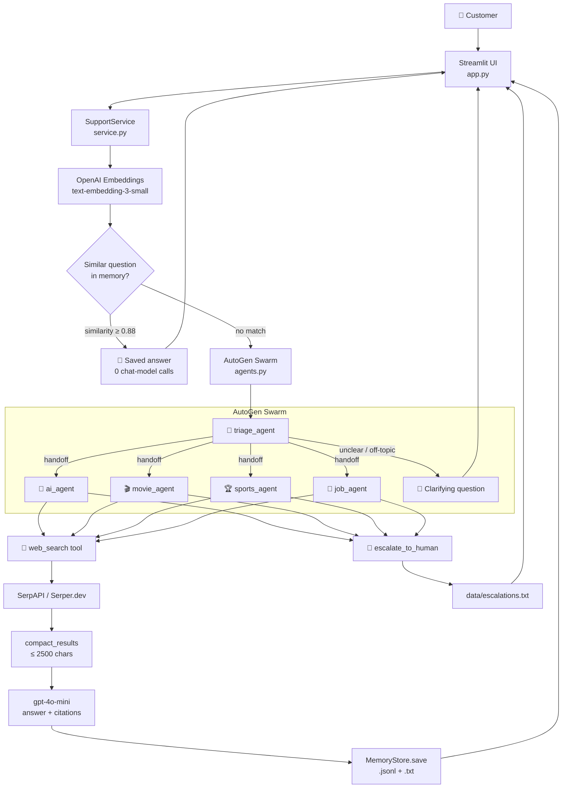

# 🛎️ NovaCare — Multi-Agent Customer Support Bot

> A conversational customer-support assistant where specialist AI agents answer questions on AI,
> movies, sports and jobs using live web search, remember each customer's past answers, and hand over
> to a human when they are not confident.


---

## 📌 Overview

**Problem.** A general-purpose chatbot answers topic questions from stale training data, repeats the
full cost of every question it has already answered, and invents an answer rather than admitting it
cannot help.

**Solution.** NovaCare routes each question to a topic specialist that must search the web before it
answers, caches answered questions per customer as semantic memory, and escalates to a human whenever
routing is ambiguous or the search fails.

**Value.**

- Answers reflect today's web, not the model's training cut-off.
- A repeat question costs one small embedding call instead of a full multi-agent run.
- The bot never silently guesses: it either cites sources, asks a question, or raises a ticket.

---

## ✨ Features

- **Multi-agent orchestration** — an AutoGen `Swarm` with a triage agent and four topic specialists.
- **Mandatory live web search** — every specialist calls a search tool before answering and cites links.
- **Dual search providers** — SerpAPI or Serper.dev, auto-detected from the key.
- **Semantic memory per customer** — OpenAI embeddings + cosine similarity over a customer's past answers.
- **Readable transcripts** — every turn appended to a plain `.txt` file per customer.
- **Refresh from web** — a one-click button to replace a remembered answer with a fresh search.
- **Human in the loop** — clarifying questions, an `escalate_to_human` tool, a search-failure safety
  net and a "Talk to a human" button, all writing tickets to a file.
- **Token accounting** — per-turn and per-session prompt/completion/embedding tokens with a cost estimate.
- **Token optimization** — memory cache, context buffering, history clipping and search-result compaction.
- **Streamlit UI** — gradient theme, agent avatars, source badges, suggested questions.
- **Test suite** — 34 tests, including offline agent tests via AutoGen's `ReplayChatCompletionClient`.

---

## 🎥 Demo

`[ADD SCREENSHOT HERE]`

`[ADD DEMO VIDEO HERE]`

Example interaction:

```text
Customer: is there any match schedule for india

🏆 Sports Desk · 🌐 Live web search · 1,160 tokens
India's upcoming fixtures:
• 2nd ODI vs Australia — Guwahati, 30 Sep
• 1st ODI is under way in Thiruvananthapuram
Sources: cricbuzz.com/cricket-team/india/2/schedule, cricinfo.com/team/india-6/match-schedule-fixtures-and-results

Customer: is there any match schedule for india        (asked again later)

🏆 Sports Desk · 🧠 From memory · 6 tokens              [🔄 Refresh with web search]
```

---

## 🏗️ Architecture



### Components

| Component | File | Responsibility |
| --- | --- | --- |
| Streamlit UI | `app.py` | Chat rendering, customer ID, source badges, token meter, refresh and human buttons |
| Support service | `support_bot/service.py` | Orchestrates memory lookup → agent run → persistence; creates tickets; handles failures |
| Agent team | `support_bot/agents.py` | Agent prompts, `Swarm` construction, termination, result and token parsing |
| Memory store | `support_bot/memory.py` | Per-customer transcript and embedding index, cosine similarity lookup |
| Search client | `support_bot/search.py` | SerpAPI / Serper.dev calls, provider detection, result compaction, failure detection |
| Settings | `support_bot/config.py` | Typed settings loaded from `.env` |

---

## 🔄 How It Works

1. **Customer identification** — the customer enters a name or ID in the sidebar; it keys their memory.
2. **Embedding** — the question is embedded with `text-embedding-3-small`.
3. **Memory lookup** — cosine similarity against that customer's previously answered questions.
4. **Cache hit** — if the best match ≥ `MEMORY_SIMILARITY_THRESHOLD`, the saved answer is returned
   immediately, tagged 🧠 From memory, with a **Refresh with web search** button. No agents run.
5. **Task construction** — on a miss, today's date plus the last 3 exchanges (clipped to 300 chars each)
   and the question are assembled into one compact task string.
6. **Triage** — the triage agent either hands off to a specialist or asks one clarifying question.
7. **Web search** — the specialist calls `web_search`; the raw provider JSON is compacted to a
   ≤ 2500-character digest of the answer box, knowledge graph, top stories and five organic results.
8. **Answer generation** — `gpt-4o-mini` answers from the search digest only, under 150 words, with
   1–3 citations.
9. **Escalation checks** — if the agent called `escalate_to_human`, or every search failed, the turn is
   marked escalated and a ticket is written.
10. **Persistence** — genuine answers are appended to the customer's `.jsonl` index with their embedding;
    every turn is appended to the `.txt` transcript.
11. **Accounting** — prompt, completion and embedding tokens are summed and shown in the sidebar.

---

## 🛠️ Tech Stack

| Category | Technology |
| --- | --- |
| Language | Python 3.11 |
| Agent framework | Microsoft AutoGen — `autogen-agentchat` 0.7.x, `autogen-ext[openai]` |
| LLM | OpenAI `gpt-4o-mini` (chat completions) |
| Embeddings | OpenAI `text-embedding-3-small` |
| Web search | SerpAPI (`serpapi.com`) or Serper.dev (`google.serper.dev`) |
| UI | Streamlit |
| Storage | Local filesystem — JSONL embedding index, plain-text transcripts and tickets |
| HTTP client | `requests` |
| Configuration | `python-dotenv` |
| Testing | `pytest`, `pytest-asyncio`, AutoGen `ReplayChatCompletionClient` |
| Process artifacts | Sarathi SDLC documents in `.sdlc/` |

No vector database or graph database is used; memory is a small per-customer JSONL file scanned in process.

---

## 📁 Project Structure

```text
Customer_chat_bot/
├── app.py                     # Streamlit UI
├── support_bot/
│   ├── __init__.py
│   ├── config.py              # Settings loaded from .env
│   ├── search.py              # SerpAPI / Serper.dev + result compaction
│   ├── memory.py              # Per-customer transcript + embedding index
│   ├── agents.py              # AutoGen agents, Swarm, result parsing
│   └── service.py             # Orchestration, tickets, token accounting
├── tests/
│   ├── __init__.py
│   ├── test_search.py         # Compaction, provider detection, failure detection
│   ├── test_memory.py         # Similarity, isolation, transcripts, ID collisions
│   ├── test_agents.py         # Routing, search, clarify, escalate (replayed LLM)
│   ├── test_service.py        # Memory hit/miss, force_web, persistence rules
│   └── test_live.py           # Real OpenAI + search calls (skipped without keys)
├── data/                      # Created at runtime, git-ignored
│   ├── memory/<id>-<hash>.txt     # Readable transcript
│   ├── memory/<id>-<hash>.jsonl   # Answered questions + embeddings
│   └── escalations.txt            # Human-handoff tickets
├── .sdlc/                     # spec.md, design.md, design.html, plan.md, wip.md
├── .env.example
├── .gitignore
├── pytest.ini
├── requirements.txt
└── README.md
```

---

## ⚙️ Prerequisites

**Mandatory**

- Python 3.11 or later (developed and tested on 3.11.9)
- An **OpenAI API key** — used for both chat completions and embeddings
- A **SerpAPI** or **Serper.dev** API key — used for web search
- Internet access

**Optional**

- Windows PowerShell — commands below use PowerShell syntax; equivalents work on Linux/macOS

---

## 🚀 Installation

```powershell
cd Customer_chat_bot

python -m venv .venv

# Windows
.\.venv\Scripts\Activate.ps1

# Linux/macOS
# source .venv/bin/activate

pip install -r requirements.txt
```

Then create your configuration file:

```powershell
Copy-Item .env.example .env
```

Edit `.env` and add your keys (see below).

---

## 🔐 Configuration

All settings come from `.env` in the project root, next to `app.py`.

| Variable | Required | Description | Example |
| --- | --- | --- | --- |
| `OPENAI_API_KEY` | Yes | OpenAI key for chat completions and embeddings | `sk-...` |
| `SERPAPI_API_KEY` | Yes | Search key — a SerpAPI **or** Serper.dev key (`SERPER_API_KEY` is also accepted) | `your-search-key` |
| `SEARCH_PROVIDER` | No | `auto` detects the provider from key length (SerpAPI = 64 chars, Serper.dev = 40). Override with `serpapi` or `serper` | `auto` |
| `OPENAI_MODEL` | No | Chat model used by all agents | `gpt-4o-mini` |
| `EMBEDDING_MODEL` | No | Embedding model used for memory similarity | `text-embedding-3-small` |
| `MEMORY_SIMILARITY_THRESHOLD` | No | Cosine similarity needed for a memory hit; higher is stricter | `0.88` |
| `HISTORY_TURNS` | No | Exchanges of chat history passed to the agents | `3` |
| `MAX_COMPLETION_TOKENS` | No | Cap on answer length | `600` |
| `DATA_DIR` | No | Where transcripts, memory and tickets are written | `./data` |

> 🔒 `.env`, `data/` and `.venv/` are listed in `.gitignore`. Never commit real keys.

---

## ▶️ Running the Application

```powershell
.\.venv\Scripts\python -m streamlit run app.py
```

Expected output:

```text
You can now view your Streamlit app in your browser.
Local URL: http://localhost:8501
```

If a key is missing the app shows:
`Missing OPENAI_API_KEY, SERPAPI_API_KEY. Copy .env.example to .env, add your keys and restart the app.`

> Restart Streamlit after changing code or `.env`; the service is cached with `@st.cache_resource`.

---

## 💻 Usage

1. Enter a name or customer ID in the sidebar, for example `alice01`. The same ID retrieves the same memory.
2. Click a suggested question or type your own.
3. Read the badges on each reply:

| Badge | Meaning |
| --- | --- |
| 🌐 Live web search | Answered from a fresh search |
| 🧠 From memory | Returned from this customer's saved answers, with the date saved |
| 💬 Clarification | Triage needs more detail, or the topic is unsupported |
| 🙋 Escalated to human | A ticket was created in `data/escalations.txt` |
| ⚠️ Error | The agent run failed; the message names the error type |

4. Press **🔄 Refresh with web search** on a remembered answer to replace it with a fresh one.
5. Press **🙋 Talk to a human** at any time to raise a ticket.
6. **🧹 Clear chat** clears the on-screen conversation only; saved memory is kept.

---

## 🤖 AI Architecture

### Implemented

**Agents** (AutoGen `Swarm`, `support_bot/agents.py`)

| Agent | Role | Tools |
| --- | --- | --- |
| `triage_agent` 🧭 | Classifies the question, hands off, or asks one clarifying question | Handoffs only |
| `ai_agent` 🤖 | AI, ML, LLMs, AI companies, tools and research | `web_search`, `escalate_to_human` |
| `movie_agent` 🎬 | Movies, releases, box office, reviews, actors, OTT, awards | `web_search`, `escalate_to_human` |
| `sports_agent` 🏆 | Scores, fixtures, players, teams, tournaments, results | `web_search`, `escalate_to_human` |
| `job_agent` 💼 | Jobs, hiring trends, openings, salaries, skills, interviews | `web_search`, `escalate_to_human` |

**Agent workflow**

```text
Customer question
    ↓
Memory check (embedding similarity) ──hit──► saved answer
    ↓ miss
triage_agent
    ├── clear topic ──► handoff to specialist
    │                        ↓
    │                   web_search (one call)
    │                        ↓
    │                   compacted results
    │                        ↓
    │                   answer with citations  ──► saved to memory
    │                        └── not confident ──► escalate_to_human ──► ticket
    └── unclear / off-topic ──► clarifying question (not saved)
```

**Prompt strategy**

- Triage: a short classification prompt listing each topic's focus, instructed to hand off silently,
  ask exactly one clarifying question when ambiguous, and never answer topic questions itself.
- Specialists: role + focus + today's date, must search once first, answer only from results, under
  150 words, cite 1–3 links, escalate on missing results or account/refund/complaint requests.

**Termination** — the team stops on the first text message from any agent
(`TextMessageTermination` per agent) or after 10 messages (`MaxMessageTermination`).

**Tools**

| Tool | Behaviour |
| --- | --- |
| `web_search(query)` | Calls SerpAPI or Serper.dev, compacts the response, returns `SEARCH_ERROR:` or `NO_RESULTS:` instead of raising |
| `escalate_to_human(reason)` | Writes a ticket to `data/escalations.txt` and returns the ticket ID |

**Memory** — semantic cache, not RAG.

| Aspect | Implementation |
| --- | --- |
| Scope | Per customer ID |
| Index | `data/memory/<id>-<hash>.jsonl` — question, answer, agent, timestamp, embedding |
| Transcript | `data/memory/<id>-<hash>.txt` — every turn, human-readable |
| Retrieval | Cosine similarity over all of that customer's stored questions, in process |
| Threshold | `MEMORY_SIMILARITY_THRESHOLD`, default `0.88` |
| Tie-breaking | The newest entry wins, so a refreshed answer supersedes the old one |
| Write policy | Only specialist answers from successful searches are stored |
| Conversation context | The last `HISTORY_TURNS` exchanges, clipped to 300 characters each |

**Token optimization**

| Technique | Where |
| --- | --- |
| Memory hit skips the whole agent run | `service.py` |
| `gpt-4o-mini` for routing and answers | `config.py` |
| Last 3 exchanges only, clipped to 300 chars | `service.build_task` |
| `BufferedChatCompletionContext(buffer_size=6)` per agent | `agents.py` |
| Search results compacted to ≤ 2500 chars | `search.compact_results` |
| `max_tool_iterations=1` — one search per turn | `agents.py` |
| `max_tokens=600` on completions | `service.py` |

### Not implemented

These are deliberately out of scope; do not expect them in the code:

- Document ingestion, chunking, RAG over private documents
- Vector or graph database
- Reranking
- Response streaming
- Automated answer-quality evaluation

---

## 🧪 Testing

Framework: `pytest` with `pytest-asyncio` (`asyncio_mode = auto` in `pytest.ini`).

```powershell
# Full suite (runs the live API tests when keys are present)
.\.venv\Scripts\python -m pytest -q

# Offline only — skip tests that call real APIs
.\.venv\Scripts\python -m pytest -q -m "not live"

# One file
.\.venv\Scripts\python -m pytest -q tests\test_memory.py
```

| Test file | Type | Covers |
| --- | --- | --- |
| `tests/test_search.py` | Unit | Result compaction and capping, Serper.dev→SerpAPI field mapping, provider detection, failure detection |
| `tests/test_memory.py` | Unit | Cosine similarity, hits above/below threshold, per-customer isolation, ID collisions, transcript format, newest-wins |
| `tests/test_agents.py` | Component | Routing, search-then-answer, clarification, escalation, search-failure detection, token totals — replayed LLM, no network |
| `tests/test_service.py` | Component | Memory hit skips agents, `force_web`, non-persistence of clarifications/escalations/failures, history inclusion, error handling, tickets |
| `tests/test_live.py` | Integration | Real OpenAI and search calls end to end; auto-skipped when keys are absent |

Unit and component tests use a deterministic fake embedder and a fake team, so they need no API keys.

**Last observed result:** `34 passed` with live keys configured; `32 passed, 2 deselected` with
`-m "not live"`.

---

## 🔍 Observability

Implemented in the sidebar and on each message:

- **Per-turn token usage** — prompt + completion + embedding tokens for the last question
- **Session totals** — cumulative prompt, completion and embedding tokens
- **Estimated cost** — computed from published list prices for `gpt-4o-mini` and
  `text-embedding-3-small`
- **Per-message source tag** — which agent answered and whether it came from web, memory, clarification,
  escalation or error
- **Memory size** — number of answers remembered for the current customer
- **Persistent logs** — `data/memory/<id>-<hash>.txt` for conversations, `data/escalations.txt` for tickets

No external tracing platform is wired in.

---

## 🔒 Security

Implemented controls:

- **Secret management** — keys are read from `.env` via `python-dotenv`; `.env` is git-ignored and
  `.env.example` contains placeholders only. Keys are never rendered in the UI or written to logs.
- **Missing-key guard** — the app blocks and names the missing variables instead of calling APIs.
- **Filesystem safety** — customer IDs are stripped to `[A-Za-z0-9_-]`, truncated, and suffixed with a
  SHA-256 fragment, preventing path traversal and cross-customer file collisions.
- **Data isolation** — memory is keyed per customer ID; one customer's answers are never retrieved for another.
- **Fail-closed search** — search errors return sentinel strings instead of raising; failed answers are
  escalated and never cached.
- **Grounded answers** — specialists are instructed to answer only from search results and to cite sources.

Not implemented: user authentication, authorization, encryption at rest, rate limiting, and dedicated
prompt-injection defences. Customer IDs are self-declared and unverified, so do not use this with real
personal data as-is.

---

## ⚠️ Limitations

- **No authentication** — anyone can type any customer ID and read that ID's memory.
- **Local file storage** — memory and tickets are plain files; there is no database, no concurrency
  control and no retention policy.
- **Linear memory scan** — every stored question is compared on each turn; fine for hundreds of
  entries, not for very large histories.
- **Four topics only** — anything outside AI, movies, sports and jobs is politely declined.
- **External dependencies** — answers require OpenAI and the search provider to be reachable; provider
  rate limits and quotas apply.
- **Search-quality ceiling** — answers can only be as good and as current as the search snippets.
- **Hallucination risk** — mitigated by mandatory search and citations, but not eliminated.
- **Stale cache** — a remembered answer is returned until the customer presses Refresh; there is no
  time-based expiry.
- **Tickets are not routed** — escalations are appended to a text file; no agent queue or notification
  is integrated.
- **Single-turn agent runs** — one search per specialist per question, so multi-step research is not performed.

---

## 🗺️ Roadmap

- [ ] Time-based expiry for cached answers
- [ ] Authentication for customer identity
- [ ] Move memory to a database or vector store for larger histories
- [ ] Route escalation tickets to a real support queue
- [ ] Streaming responses in the UI
- [ ] Automated answer-quality evaluation
- [ ] Docker deployment and CI

---

## 🐛 Troubleshooting

### Problem: replies say "I'm currently unable to access the latest information"

**Solution.** The search provider rejected the key. Confirm the key is active and that
`SEARCH_PROVIDER` matches it — SerpAPI keys are 64 characters, Serper.dev keys are 40. With
`SEARCH_PROVIDER=auto` this is detected automatically. Such replies are escalated with a ticket and are
not cached, so fixing the key is enough.

### Problem: `Missing OPENAI_API_KEY, SERPAPI_API_KEY` banner

**Solution.** `.env` is absent or in the wrong directory. It must sit beside `app.py`. Copy
`.env.example` to `.env`, fill in the keys, and restart Streamlit.

### Problem: code or `.env` changes have no effect

**Solution.** Stop Streamlit with `Ctrl+C` and start it again; the service is cached with
`@st.cache_resource` for the process lifetime.

### Problem: the wrong specialist answers

**Solution.** Rephrase including the topic keyword, or extend that specialist's `focus` text in
`support_bot/agents.py`.

### Problem: too many or too few memory hits

**Solution.** Adjust `MEMORY_SIMILARITY_THRESHOLD`. Raising it towards `0.95` forces more live searches;
lowering it towards `0.80` reuses answers more aggressively.

### Problem: a wrong or outdated answer keeps coming back

**Solution.** Press **🔄 Refresh with web search** on that message, or delete the customer's files in
`data/memory/`.

### Problem: `ModuleNotFoundError: No module named 'support_bot'`

**Solution.** Run commands from the project root using the virtual environment interpreter, for example
`.\.venv\Scripts\python -m pytest -q`.

---

## 🤝 Contributing

1. Fork the repository
2. Create a feature branch
3. Make your changes
4. Add or update tests in `tests/`
5. Run `.\.venv\Scripts\python -m pytest -q` and confirm the suite is green
6. Commit and push the branch
7. Open a Pull Request

Design, specification and plan documents live in `.sdlc/` and should be updated alongside behavioural changes.

---

## 📄 License

`[ADD LICENSE INFORMATION]`

---

## 👨‍💻 Author

`[ADD AUTHOR INFORMATION]`
